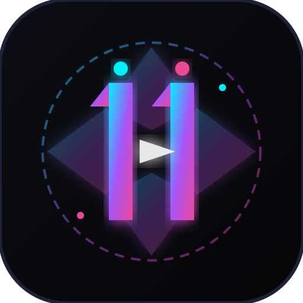

# 11AICreate — Cross-Platform AI Cinema & Visual Generation Studio

<div align="center">
  
  <br />
  <strong>Turn Imagination into Cinematic Videos, 8K Photorealistic Renders & Creative Prompts</strong>
  <br /><br />
  
  
  
  
  
  
</div>

---

## 1. Vision & Concept
**11AICreate** is an enterprise-grade cross-platform generative AI studio designed and engineered by **[11Hopem](https://11hopem.com)**. It empowers film creators, designers, digital marketers, and storytellers to synthesize mind-bending AI cinema videos, hyper-realistic 8K photography, and multi-agent AI director prompts within a unified high-velocity workspace.

Featuring a dark obsidian cyber-motion aesthetic reminiscent of Runway, Sora, and Luma, 11AICreate offers a seamless creative experience across Web, native iOS (SwiftUI), and native Android (Jetpack Compose).

---

## 2. Project Registry & Live Links
- **GitHub Repository**: [umutocguder/11aicreate](https://github.com/umutocguder/11aicreate) (Private)
- **Production Web Studio**: [https://11aicreate.vercel.app](https://11aicreate.vercel.app)
- **Unified Cloud Ecosystem**: `hopem-software-cloud` (Firebase & Supabase)
- **Owner & Author**: [11Hopem](https://11hopem.com) (`umutocgdr@gmail.com`)
- **Workspace Path**: `/Users/umut/mycodespaces/11aicreate`

---

## 3. Real-World Creator & Studio Details
- **Target Audience**: Film directors, VFX artists, game designers, content creators, and AI enthusiasts.
- **Unified Backend**: All three platforms (Web, iOS, Android) connect to the identical Supabase PostgreSQL database and synchronization engine.
- **Monetization Engine**:
  - **1 Free Trial Generation**: Every user can produce 1 high-resolution visual without upfront payment.
  - **Paywall Gating**: Subsequent creations require a creator plan:
    - `Creator Starter`: $19/mo (120 Video Credits + 500 Photos)
    - `Pro Studio`: $49/mo (450 Video Credits + Unlimited Photos + Dedicated GPU Queue)
    - `Agency Enterprise`: $149/mo (1,800 Video Credits + Custom LoRA Models + REST API)

---

## 4. Key Features & Interactive Modules
1. **Endless Cyber Video Marquee**: Continuous GPU-accelerated video strip showcasing viral AI creations with view/like metrics and 1-click prompt inspection.
2. **Generative AI Studio**:
   - 🎬 **AI Video Generator**: Model selection (`11Cinema-Ultra-v2`, `Kling Motion`, `Luma Diffusion`), aspect ratios (`16:9`, `9:16`, `1:1`, `21:9`), and instant 4K export.
   - 📸 **AI Photo Studio**: 8K photorealistic render engine with camera depth and lighting controls.
   - 💬 **AI Director Copilot**: Intelligent prompt enhancer providing cinematography recommendations, lens suggestions, and lighting setups.
3. **1-Trial Paywall Protection**: Instant modal trigger once the initial free trial is consumed, offering seamless upgrade pathways.
4. **Cross-Platform Native Synchronization**:
   - **iOS App**: Pure SwiftUI 6 architecture with AVPlayer haptic playback and StoreKit integration.
   - **Android App**: Kotlin 2.0 with Jetpack Compose 1.7, Material3 Dark Cyber Neon theme, and ExoPlayer video cards.

---

## 5. Architecture & Directory Tree
```
11aicreate/
├── .github/
│   └── workflows/
│       └── ci-cd.yml          # Automated CI/CD pipeline (master & dev)
├── android/                   # Native Android Jetpack Compose App
│   └── app/src/main/java/com/elevenaicreate/app/
│       ├── MainActivity.kt
│       ├── ElevenAICreateApp.kt
│       └── Theme.kt
├── assets/
│   └── images/
│       └── logo.svg           # High-resolution vector monogram logo
├── data/
│   └── backups/               # Rule 17 Autonomous SHA-256 snapshots
├── ios/                       # Native iOS SwiftUI App
│   └── ElevenAICreate/Sources/
│       ├── ElevenAICreateApp.swift
│       ├── ContentView.swift
│       └── AppViewModel.swift
├── public/                    # Production static web assets
│   ├── favicon.svg            # 1:1 Synchronized favicon
│   ├── favicon.ico
│   ├── logo.svg
│   ├── style.css              # Cyber-motion dark design system
│   ├── app.js                 # Studio client & paywall logic
│   ├── robots.txt
│   ├── sitemap.xml
│   └── index.html
├── scripts/
│   ├── backupService.js       # Rule 17 Cryptographic backup engine
│   └── lintCheck.js           # Rule 20 Static code quality auditor
├── supabase/
│   └── schema.sql             # Unified PostgreSQL schema, RLS & seed data
├── tests/
│   ├── blueprint.test.js      # Blueprint, brand & metadata validation
│   └── studio.test.js         # 1-trial paywall and generation tests
├── web/                       # Source web modules
│   └── src/
│       ├── lib/
│       │   ├── supabaseClient.js
│       │   └── studioEngine.js
│       └── telemetry/
│           └── firebaseLogger.js
├── AGENTS.md                  # Developer guidelines and commands
├── CLAUDE.md                  # Claude Code sync
├── package.json               # Manifest & scripts
├── README.md                  # Comprehensive documentation
├── vercel.json                # Vercel deployment & security headers
└── WORKLOG.md                 # AI handoff activity log
```

---

## 6. Security & Legal Shield
- **Strict Data Isolation**: Zero contamination with corporate repositories.
- **Row Level Security (RLS)**: Enforced in PostgreSQL ensuring users access only their own wallet and prompt histories.
- **Zero Hardcoded Secrets**: Sensitive credentials excluded via `.gitignore`.
- **Content Security & Sanitization**: Strict CSP headers in `vercel.json` and client-side XSS protection.

---

## 7. Firebase Telemetry & Cloud Metrics (Rule 18)
- Real-time client telemetry and generation audits stream non-blocking to Google Cloud Firestore (`hopem-software-cloud`).
- Events tracked include `page_view_home`, `showcase_prompt_selected`, `generation_success`, and `paywall_triggered_generation_attempt`.

---

## 8. Autonomous Backup & Data Integrity (Rule 17)
- Cryptographic SHA-256 rolling logs created before every build and test execution via `scripts/backupService.js`.
- Maintains 100% local custody of pricing matrices and schema definitions.

---

## 9. Installation, Testing & Quality Assurance

### Prerequisites
- Node.js v20.0.0 or higher
- Git

### Running Tests
Execute the native zero-dependency automated test suite:
```bash
npm test
```

### Running Static Lint Check
Execute the code header and quality analyzer:
```bash
npm run lint
```

### Running Autonomous Backup
```bash
npm run backup
```

### Running Web Studio Locally
```bash
npm run dev
```

---

## 10. Attribution, Copyright & Legal Notice
Created by **[11Hopem](https://11hopem.com)**.

Copyright &copy; 2026 **[11Hopem](https://11hopem.com)**. All rights reserved.
Licensed under the 11Hopem Proprietary License.
All intellectual property, branding assets, code frameworks, and documentation remain the exclusive property of 11Hopem.
